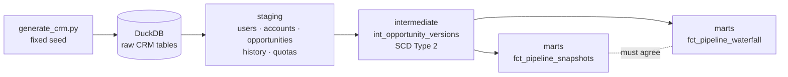

# GTM Revenue Operations Mart

[](https://github.com/rajib-k-das/gtm-revenue-operations-mart/actions/workflows/ci.yml)

A dbt + DuckDB warehouse for B2B sales pipeline analytics, built on a Salesforce-style CRM extract, that answers the
questions a revenue operations team is asked every week:

- **What did the pipeline look like on any past date,** not just today?
- **How did this quarter's pipeline move:** what was created, pulled in, won, lost or pushed out?
- **Where do deals slip, and when in the quarter?**
- **Which forecasts can be trusted?** *(Layer 2)*

## The data, and why it is synthetic

Real CRM data is never public, so `generate/generate_crm.py` generates a fictional B2B SaaS company, **Kestrel Cloud**:
24 account executives across two segments and three regions, 3,000 accounts and about 4,000 opportunities over three years,
with the full change history of every opportunity (stage, amount, close date, forecast category).

The generator **plants five known behaviours** (end-of-quarter deal scrubs, a closing hockey stick, a region with inflated
pipeline, reps with forecast bias, and longer, larger Enterprise deals). The analysis is judged by whether it finds them:
a known-answer test at the scale of a whole company ([decision 003](docs/decisions.md)).

## What it produces

| Layer | Output | Status |
|---|---|---|
| Generation | Reproducible CRM extract: users, accounts, opportunities, opportunity history, quotas | ✅ Done |
| Ingestion | Header checks, load to DuckDB | ✅ Done |
| Staging | Typed models for each CRM object | ✅ Done |
| Intermediate | `int_opportunity_versions`: every opportunity as SCD Type 2 (`valid_from` / `valid_to`) | ✅ Done |
| Marts | `fct_pipeline_snapshots`: open pipeline at the end of every week and quarter | ✅ Done |
| Marts | `fct_pipeline_waterfall`: quarterly waterfall per rep that reconciles to the cent | ✅ Done |
| Marts | Win rates, stage conversion and velocity, forecast accuracy by rep, ARR bridge | 🔜 Layer 2 |
| BI | Tableau Public dashboard | 🔜 Layer 2 |

## Architecture



## The pipeline waterfall

For each quarter and rep, how the pipeline due in that quarter moved:

> opening + created + pulled in − won − lost − moved out ± amount change = **closing**

It reconciles to the cent, and its opening and closing are checked against the snapshot model, which is built
independently. Agreement between the two is the evidence that history is rebuilt correctly.

## Testing

dbt tests run on every push (GitHub Actions), twice: on a hand-built test company and on the full generated company.

- **Known answers:** five hand-built deals (won, pushed out, created in quarter, pulled in then lost, overdue but open)
  with every waterfall bucket worked out by hand ([tests/fixtures](tests/fixtures/README.md)).
- **History integrity:** one current version per opportunity, no gaps or overlaps, and the rebuilt current state matches
  the CRM's current-state table exactly.
- **Reconciliation:** every waterfall row adds up, and opening and closing match the independent snapshots.

## Key design decisions

Logged with alternatives in [`docs/decisions.md`](docs/decisions.md). Highlights:

- **History as SCD Type 2,** rebuilt from the CRM's change log, so any past date can be queried.
- **One definition per metric,** written down and tested.
- **A lost deal counts against the quarter it was due in,** because the CRM overwrites a lost deal's close date with
  the loss date. Taken at face value, losses came out roughly double their true size (decision 006).

## How to run it

Requires Python 3.11+.

```bash
python3 -m venv .venv && source .venv/bin/activate
pip install -r requirements.txt

python generate/generate_crm.py      # writes data/raw/*.csv (identical every run)
python ingest/load_crm.py
dbt build
python scripts/summarize_findings.py # waterfall by quarter, and checks for the planted behaviours
```

Hand-built test company instead: `python ingest/load_crm.py --raw-dir tests/fixtures && dbt build`.

## Tech stack

Python (NumPy, DuckDB) · dbt Core · SQL · GitHub Actions (CI) · Tableau Public
