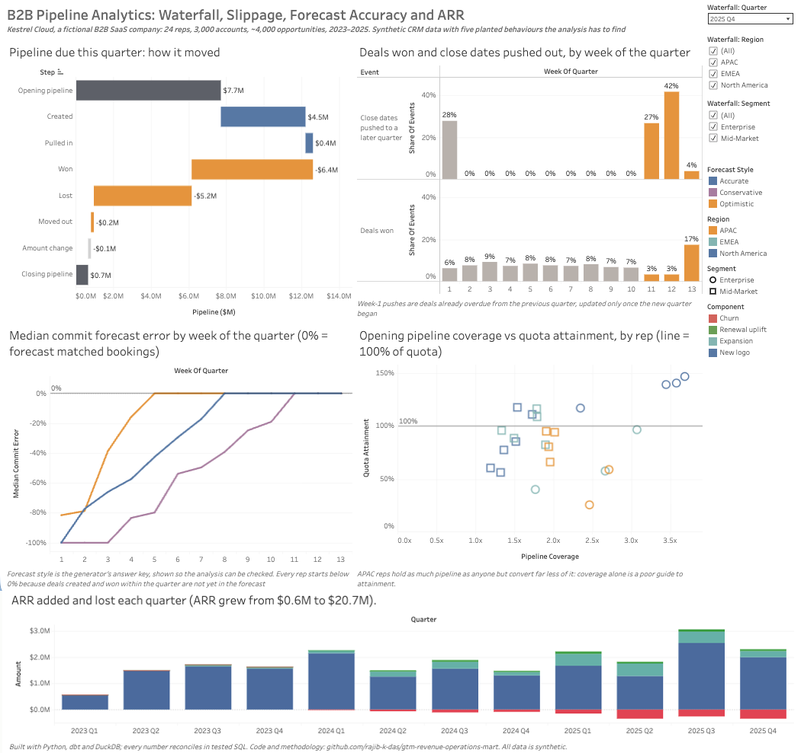
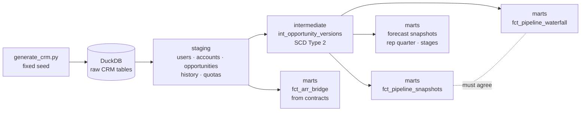

# GTM Revenue Operations Mart

[](https://github.com/rajib-k-das/gtm-revenue-operations-mart/actions/workflows/ci.yml)

A dbt + DuckDB warehouse for B2B sales pipeline analytics, built on a Salesforce-style CRM extract, that answers the
questions a revenue operations team is asked every week:

- **What did the pipeline look like on any past date,** not just today?
- **How did this quarter's pipeline move:** what was created, pulled in, won, lost or pushed out?
- **Where do deals slip, and when in the quarter?**
- **Which reps' forecasts can be trusted,** and from which week of the quarter?
- **How is ARR moving:** new logos, expansion, renewal uplift, churn?

**[Live dashboard on Tableau Public ↗](https://public.tableau.com/app/profile/rajib.kumar.das/viz/B2BPipelineAnalytics/B2BPipelineAnalytics)**

[](https://public.tableau.com/app/profile/rajib.kumar.das/viz/B2BPipelineAnalytics/B2BPipelineAnalytics)

## The data, and why it is synthetic

Real CRM data is never public, so `generate/generate_crm.py` generates a fictional B2B SaaS company, **Kestrel Cloud**:
24 account executives across two segments and three regions, 3,000 accounts and about 4,000 opportunities over three years,
with the full change history of every opportunity (stage, amount, close date, forecast category) and the subscription
contracts created by won deals.

The generator **plants five known behaviours** (end-of-quarter deal scrubs, a closing hockey stick, a region with inflated
pipeline, reps with forecast bias, and longer, larger Enterprise deals). The analysis is judged by whether it finds them:
a known-answer test at the scale of a whole company ([decision 003](docs/decisions.md)).

## What it produces

| Layer | Output | Status |
|---|---|---|
| Generation | Reproducible CRM extract: users, accounts, opportunities, opportunity history, contracts, quotas | ✅ Done |
| Ingestion | Header checks, load to DuckDB | ✅ Done |
| Staging | Typed models for each CRM object | ✅ Done |
| Intermediate | `int_opportunity_versions`: every opportunity as SCD Type 2 (`valid_from` / `valid_to`) | ✅ Done |
| Marts | `fct_pipeline_snapshots`: open pipeline at the end of every week and quarter | ✅ Done |
| Marts | `fct_pipeline_waterfall`: quarterly waterfall per rep that reconciles to the cent | ✅ Done |
| Marts | `dim_opportunity` and `fct_opportunity_stages`: outcome, cycle time, pushes, stage conversion and velocity | ✅ Done |
| Marts | `fct_forecast_snapshots`: each rep's weekly commit and best-case forecast vs actual bookings | ✅ Done |
| Marts | `fct_rep_quarter`: quota, bookings, attainment and opening pipeline coverage | ✅ Done |
| Marts | `fct_arr_bridge`: quarterly ARR bridge by region that reconciles to opening and closing ARR | ✅ Done |
| Tests | Recovery of all five planted behaviours, verified to fail when a behaviour is removed | ✅ Done |
| BI | [Tableau Public dashboard](https://public.tableau.com/app/profile/rajib.kumar.das/viz/B2BPipelineAnalytics/B2BPipelineAnalytics), from five view-shaped exports ([guide](docs/dashboard_guide.md)) | ✅ Done |

## Architecture



## What the data showed

All five planted behaviours are recovered by the marts, and a test fails if any of them is lost:

| Planted | Recovered |
|---|---|
| P1 end-of-quarter scrub | 72% of close-date pushes into a later quarter happen in weeks 11–13; the rest are in week 1 |
| P2 hockey stick | 17% of new-bookings wins land in the last 7 days of the quarter, over twice an even share |
| P3 inflated APAC pipeline | APAC reps create 14.6 new deals a quarter vs ~9 elsewhere, but win 8.5% of pipeline value vs 15–21% |
| P4 forecast bias | At week 6, optimistic reps' commit sits at 0% median error, accurate reps' at −29%, conservative reps' at −54% |
| P5 Enterprise deals | median won deal $107,500 vs $23,500, taking 130 days vs 62 |

What a revenue leader would take from it:

- **Coverage alone misleads.** APAC starts quarters with 2.2× pipeline coverage, close to North America's 2.4×, yet
  attains 67% of quota against North America's 110%. Coverage has to be read with each region's conversion rate.
- **Stale deals are cleaned up a quarter late.** Every close-date push in week 1 of a quarter (28% of all pushes) is a
  deal that was already overdue from the previous quarter and was only updated once the new quarter began. Those deals
  sat in last quarter's pipeline as if they could still close.
- **The forecast is only trustworthy late.** Even accurate reps' commit sits about 30% below the final number at
  week 6, because many deals are created and won inside the quarter. Rep-level bias is visible from week 4.
- **ARR grew from $0.6M to $20.7M in three years,** driven by new logos ($1.3–2.5M a quarter). Churn rose with the
  base, to about $0.3M a quarter by 2025, while renewal uplift added under $0.1M.

## The pipeline waterfall

For each quarter and rep, how the pipeline due in that quarter moved:

> opening + created + pulled in − won − lost − moved out ± amount change = **closing**

It reconciles to the cent, and its opening and closing are checked against the snapshot model, which is built
independently. Agreement between the two is the evidence that history is rebuilt correctly.

## Testing

dbt tests run on every push (GitHub Actions), twice: on a hand-built test company and on the full generated company.

- **Known answers:** five hand-built deals (won, pushed out, created in quarter, pulled in then lost, overdue but open)
  with every waterfall bucket worked out by hand ([tests/fixtures](tests/fixtures/README.md)).
- **History integrity:** one current version per opportunity, no gaps or overlaps, and the rebuilt current state matches
  the CRM's current-state table exactly.
- **Reconciliation:** every waterfall row adds up, and opening and closing match the independent snapshots; every ARR
  bridge row adds up to ARR computed independently from active contracts.
- **Planted behaviours:** the marts must recover P1–P5. Verified by switching behaviours off in the generator, which
  makes the test fail ([decision 011](docs/decisions.md)).

## Key design decisions

Logged with alternatives in [`docs/decisions.md`](docs/decisions.md). Highlights:

- **History as SCD Type 2,** rebuilt from the CRM's change log, so any past date can be queried.
- **One definition per metric,** written down and tested.
- **ARR from contracts, not opportunities,** so renewals link to what they renew and churn is told apart from a late
  renewal (decision 009).
- **A lost deal counts against the quarter it was due in,** because the CRM overwrites a lost deal's close date with
  the loss date. Taken at face value, losses came out roughly double their true size (decision 006).

## How to run it

Requires Python 3.11+.

```bash
python3 -m venv .venv && source .venv/bin/activate
pip install -r requirements.txt

python generate/generate_crm.py      # writes data/raw/*.csv (identical every run)
python ingest/load_crm.py
dbt build
python scripts/summarize_findings.py # waterfall, planted behaviours, forecast accuracy, attainment, ARR
python scripts/export_for_tableau.py # five CSV files for the dashboard (exports/)
```

Hand-built test company instead: `python ingest/load_crm.py --raw-dir tests/fixtures && dbt build`.

## Tech stack

Python (NumPy, DuckDB) · dbt Core · SQL · GitHub Actions (CI) · Tableau Public
